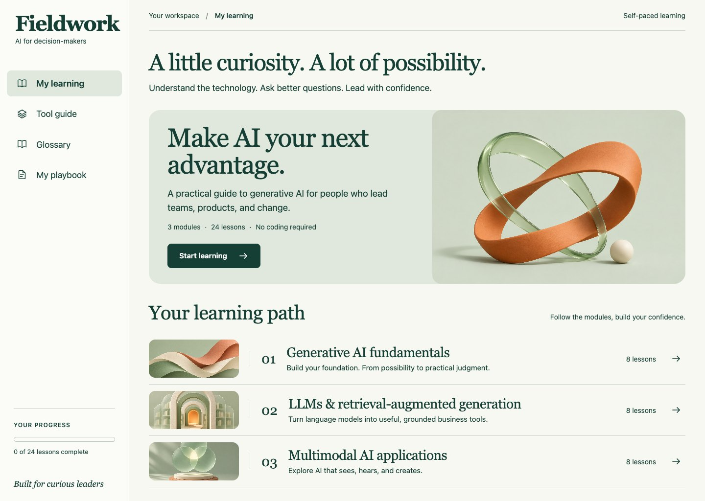
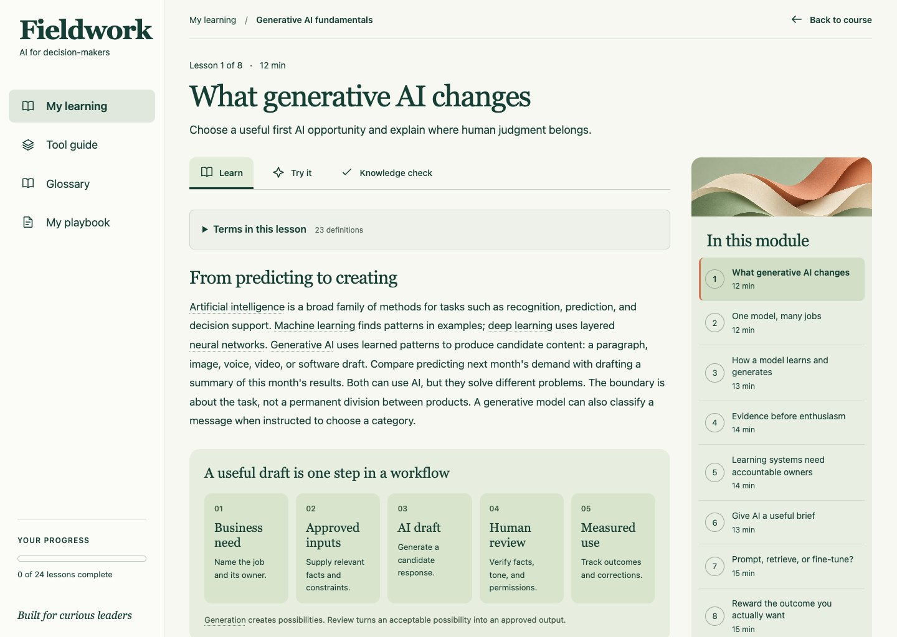
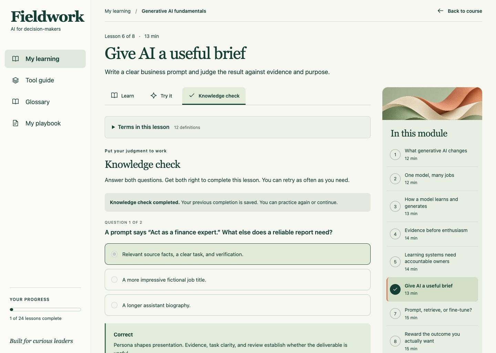
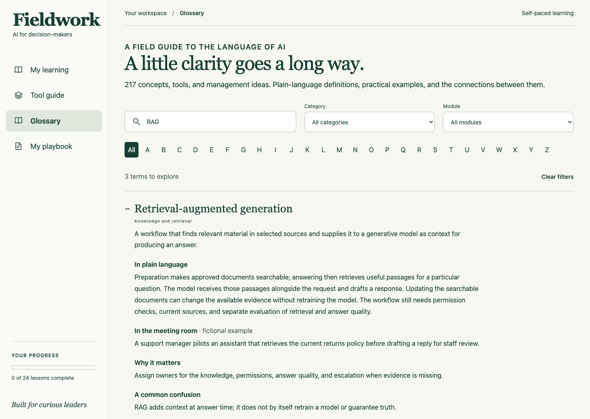
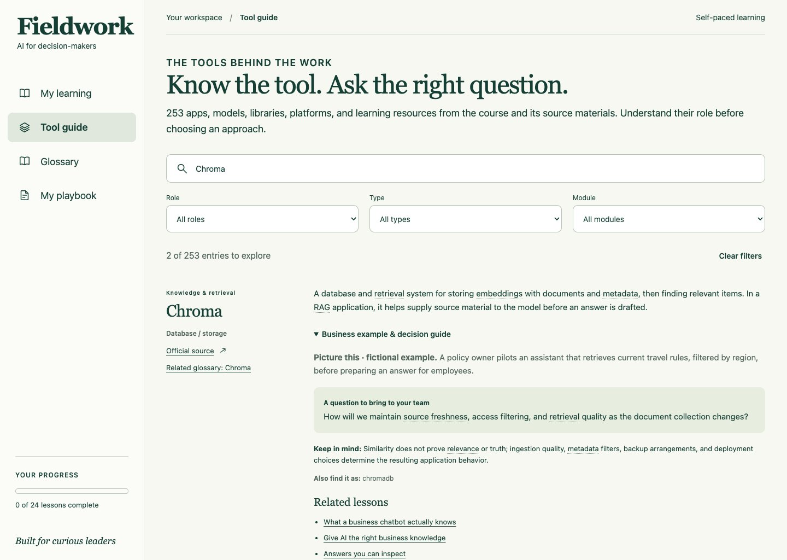
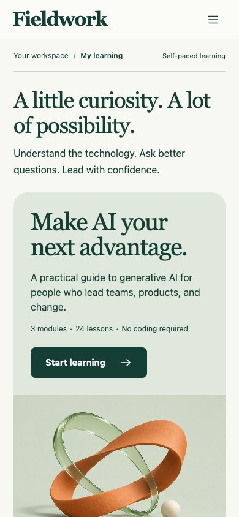

# Fieldwork

### Generative AI for decision-makers

An interactive course for managers, product leaders, and business teams who want to understand AI, evaluate useful opportunities, and lead a practical pilot. Learn the concepts, explore the tools, and practice the decisions—no coding knowledge required.

**3 modules · 24 lessons · 48 quiz questions · 217 glossary entries · 253 tools**

[Get started](#getting-started) · [Explore the curriculum](#what-youll-learn) · [See the app](#a-look-inside) · [Contribute](#contributing)



## Built for the decisions managers make

- **Find a worthwhile use case.** Connect model capabilities to a concrete business problem, measurable outcomes, and human review.
- **Practice before proposing a pilot.** Work through 24 decision activities and 48 quiz questions with explanations and retries.
- **Understand unfamiliar language in context.** Hover or focus on highlighted terms for a short definition; click or tap for the full glossary entry.
- **Make sense of the tool landscape.** Explore 253 apps, models, libraries, platforms, datasets, and example systems, with business scenarios, limitations, and questions to ask your team.
- **Leave with a plan.** Save lesson reflections and develop a six-part pilot brief that you can download and share.

The course uses prepared educational examples and included illustrations. It runs without an AI account, API keys, or a backend; it does not call live models or generate content on demand.

## What you'll learn

Each module contains eight lessons. Estimated lesson times are 10–16 minutes, including reading and practice; move at your own pace.

| Module                                         | Topics                                                                                            | What you can take into a team conversation                                                                       |
| ---------------------------------------------- | ------------------------------------------------------------------------------------------------- | ---------------------------------------------------------------------------------------------------------------- |
| **01 · Generative AI fundamentals**            | Foundation models, training and inference, evaluation, prompting, fine-tuning, and accountability | Explain what AI can do, choose an adaptation approach, and define a useful first pilot.                          |
| **02 · LLMs & retrieval-augmented generation** | Language models, tokens, embeddings, semantic search, model selection, RAG, and answer evaluation | Assess a knowledge assistant, inspect its evidence, and distinguish retrieval problems from generation problems. |
| **03 · Multimodal AI applications**            | Image understanding and generation, speech, audio, video, deployment, and launch decisions        | Choose suitable inputs and outputs, evaluate consequential errors, and establish review and stop conditions.     |

Every lesson follows **Learn → Try it → Knowledge check**. Both quiz answers must be correct to mark a lesson complete. You can retry and revisit any lesson. Retakes preserve completed progress, and opening a glossary definition keeps your current lesson attempt and reflection intact.

The pilot playbook brings the course together around six questions: What problem will you solve? Who will use it? What information may it use? What does success look like? Who reviews the results? When would you pause or stop?

## A look inside

These are screenshots of the running application. Click an image for a larger view.

<table>
  <tr>
    <td width="50%">
      <a href="docs/screenshots/lesson.jpg"></a>
      <p><strong>Learn with context.</strong> Plain-language explanations, visual workflows, and definitions alongside the lesson.</p>
    </td>
    <td width="50%">
      <a href="docs/screenshots/quiz.jpg"></a>
      <p><strong>Practice your judgment.</strong> Scenario-based questions explain why an answer works and support another attempt.</p>
    </td>
  </tr>
  <tr>
    <td width="50%">
      <a href="docs/screenshots/glossary.jpg"></a>
      <p><strong>Build a shared vocabulary.</strong> Search 217 terms by name or alias and explore examples, related concepts, and lessons.</p>
    </td>
    <td width="50%">
      <a href="docs/screenshots/tools.jpg"></a>
      <p><strong>Understand the tools.</strong> Filter by role, type, and module; inspect practical guidance and primary sources.</p>
    </td>
  </tr>
</table>

<details>
<summary>See the mobile layout</summary>

The responsive interface includes a compact navigation menu and touch-accessible definitions.



</details>

## Getting started

You'll need **Node.js 22.12 or later**, npm, and Git. Development has been verified with Node.js 24.

```sh
git clone https://github.com/felipe-cosse/generative-ai-course.git
cd generative-ai-course
npm ci
npm run dev
```

Open [http://127.0.0.1:5173](http://127.0.0.1:5173), or the local address printed by Vite if that port is already in use. No environment variables or original course archive are required to use the app.

### Commands

| Command           | Purpose                                                          |
| ----------------- | ---------------------------------------------------------------- |
| `npm run dev`     | Start the local development server.                              |
| `npm test`        | Run curriculum, glossary, tools, search, and saved-state checks. |
| `npm run build`   | Create the static production application in `dist/`.             |
| `npm run preview` | Preview the production build locally, normally on port 4173.     |

To preview a production build:

```sh
npm run build
npm run preview
```

The app uses hash-based navigation, such as `#/tools` and `#/lesson/f1`. Serve `dist/` through a static web host at the **site root**. Hosting under a subdirectory requires adjusting Vite's base and the root-relative asset paths first. `npm run preview` is for local inspection, not production hosting.

### Optional source verification

The original source archive is separate from this repository. If you have access to it, you can also validate the archived file references (macOS/Linux):

```sh
SOURCE_ARCHIVE='/path/to/Udacity Generative AI' npm test
```

Without that variable, the archive-presence tests are skipped; the remaining checks still run. See the [tools review](docs/06-tools-review.md) and [glossary verification](docs/05-glossary-verification.md) for recorded test coverage and browser limitations.

## Your progress and notes

Progress, lesson reflections, and pilot fields are saved in your browser's local storage. There is no learner account or server-side synchronization. Work belongs to the exact browser origin, so changing browser profiles, hostnames, or ports creates a separate space. Clearing browser data removes the saved work.

Use **Download playbook** to keep a plain-text copy of your current pilot brief and saved lesson notes. If browser storage is unavailable, the app displays a warning and remains usable for the current session. Use general or fictional examples when writing notes; this is a learning workspace, not a confidential-records system.

## Project structure

Built with **React 19**, **Vite 8**, and plain CSS. Content is stored locally, and automated checks use Node's built-in test runner.

```text
src/
  components/       Course, lessons, quizzes, glossary, tools, and playbook
  data/             Three course modules, glossary entries, and tool catalog
  glossary.js       Term matching and glossary search
  tools.js          Tool search and combined filters
  state.js          Progress, reflections, and playbook persistence
public/images/      Included course illustrations
docs/               Curriculum plans, source audits, and verification records
  screenshots/      Application images used in this README
tests/              Content integrity, search, matching, and state tests
```

## Contributing

Corrections and improvements are welcome. For a content issue, identify the lesson, term, or tool; describe the problem; and include a primary source where possible. For a UI issue, include the route, browser, screen size, and steps to reproduce it.

When preparing a change:

1. Keep learner-facing explanations clear, practical, and free of code requirements.
2. Preserve stable lesson and glossary IDs so saved progress and links continue to work.
3. Update the relevant inventory when adding glossary or tool entries, and verify related terms, lesson references, aliases, and source links.
4. Run `npm test` and `npm run build`. Check desktop and mobile behavior for visual changes.

Please do not include credentials, personal learner data, or copies of proprietary course videos and notebooks in contributions.

## Project notes and sources

- [Course plan and learning objectives](docs/01-course-plan.md)
- [Interface design plan](docs/02-interface-plan.md)
- [Glossary coverage](docs/glossary-coverage.md) and [verification](docs/05-glossary-verification.md)
- [Tools inventory, review scope, exclusions, and verification](docs/06-tools-review.md)
- [Original course implementation checks](docs/03-verification.md)

Fieldwork is an independent educational project informed by a separately supplied Udacity course archive. It contains original management-focused adaptations, fictional business scenarios, generated illustrative artwork, and source references. Original course videos and notebooks are not bundled with the app. **This project is not affiliated with or endorsed by Udacity.**

Named tools illustrate roles and tradeoffs; inclusion is not a ranking or purchasing recommendation. Their primary references were reviewed on November 13, 2026. Capabilities, maintenance status, licensing, and availability can change. The guide records its audit scope and identifies historical or discontinued examples.

## License

A project license has not yet been specified in this repository. Referenced products and third-party course materials remain subject to their own terms.
